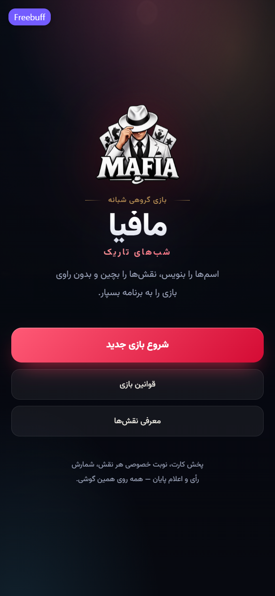
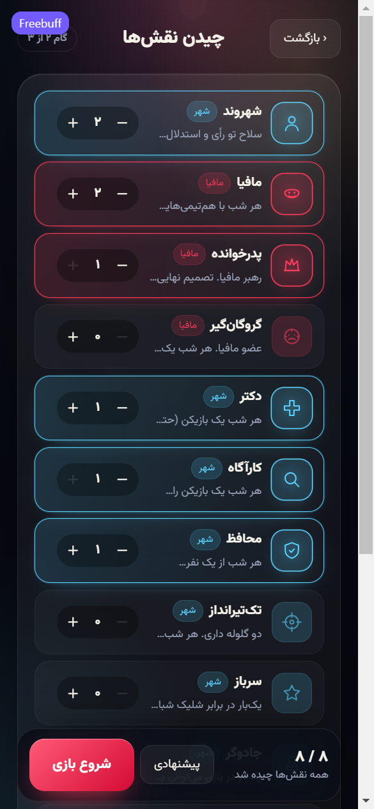
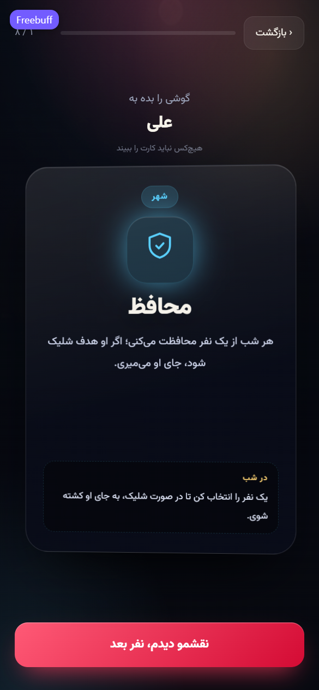
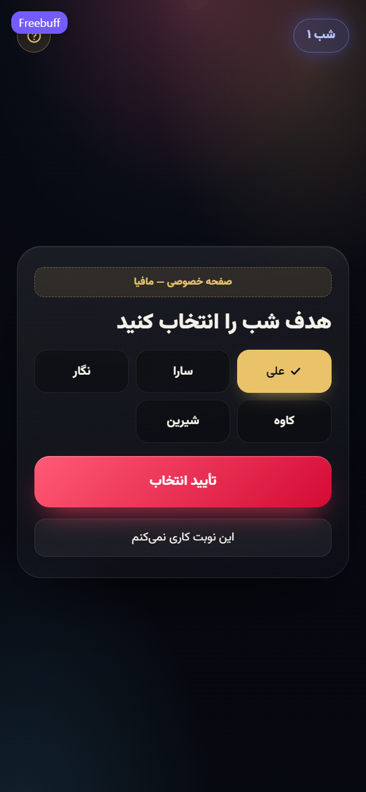
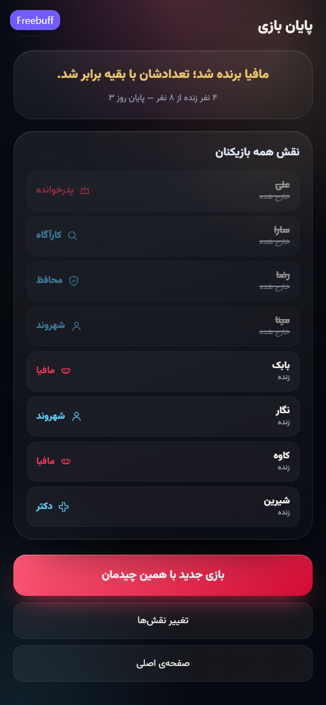
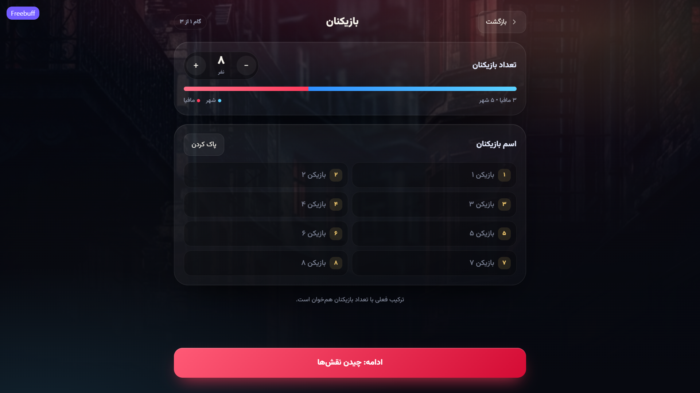

# مافیا — شب‌های تاریک

بازی گروهی مافیا برای یک گوشی؛ بدون راوی انسانی، بدون اینترنت و بدون نصب. اسم بازیکنان را وارد می‌کنی، نقش‌ها را می‌چینی و برنامه خودش نوبت‌های شب، کشته‌ها، رأی‌گیری و پایان بازی را اداره می‌کند.



## امکانات

- **بدون راوی:** هر نقش در نوبت خودش یک صفحهٔ خصوصی می‌گیرد، هدفش را انتخاب می‌کند و صفحه بسته می‌شود.
- **اسم به‌جای شماره:** ۵ تا ۲۰ بازیکن با اسم دلخواه؛ ترکیب شهر و مافیا به‌صورت زنده نمایش داده می‌شود.
- **چیدن نقش:** ۱۳ نقش، شمارندهٔ هر نقش و دکمهٔ «پیشنهادی» برای ترکیب متعادل.
- **پخش مخفی کارت:** کارت با انیمیشن باز می‌شود و تا بسته‌شدن کامل کارت، نقش نفر بعد نمایش داده نمی‌شود.
- **شب و روز:** انتخاب هدف مافیا، نجات دکتر، محافظ، استعلام کارآگاه، شلیک تک‌تیرانداز، سکوت جادوگر، گروگان‌گیری.
- **رأی‌گیری مخفی:** هر بازیکن رأی خودش را روی همان گوشی ثبت می‌کند؛ برنامه رأی‌ها را می‌شمارد، اعدام را اعلام می‌کند و وکیل می‌تواند حکم را یک‌بار لغو کند.
- **پایان خودکار:** حذف کامل مافیا، برابر شدن تعداد مافیا با بقیه یا اعدام دلقک، بازی را با افشای نقش همه تمام می‌کند.
- **آفلاین و موبایل‌پسند:** راست‌به‌چپ، فونت محلی Vazirmatn، بدون build و بدون هیچ وابستگی خارجی.

## اجرا

هیچ مرحلهٔ ساخت یا نصبی ندارد. کافی است `index.html` را باز کنی:

- روی کامپیوتر: دوبار کلیک روی `index.html`
- روی گوشی: فایل‌ها را کنار هم نگه دار و `index.html` را با مرورگر باز کن
- یا با یک سرور محلی ساده:

```bash
python -m http.server 5173
# سپس http://127.0.0.1:5173/index.html
```

> اسکریپت‌ها عمداً «کلاسیک» و بدون ES Module هستند تا اجرای مستقیم فایل با `file://` هم کار کند.

### انتشار روی GitHub Pages

پروژه کاملاً استاتیک است، پس بدون هیچ تنظیم اضافه‌ای منتشر می‌شود: در ریپازیتوری به **Settings → Pages** برو و شاخهٔ `main` و پوشهٔ `/ (root)` را انتخاب کن. آدرس صفحه چیزی شبیه `https://<username>.github.io/<repo>/` می‌شود.

## ساختار پروژه

```
index.html                 همهٔ صفحه‌ها، بدون منطق بازی
styles/
  base.css                 فونت، رنگ، پس‌زمینه، چیدمان
  components.css           دکمه، پنل، فهرست نقش، کارت مرحله، هدف‌ها
  pages.css                صفحهٔ خانه، کارت پخش، هدر بازی، پایان
js/
  app.js                   راه‌انداز: mount صفحه‌ها و شروع
  store.js                 وضعیت مشترک بازی و ترکیب نقش‌ها
  core/
    dom.js                 کمک‌های DOM و عدد فارسی
    icons.js               مجموعهٔ آیکون‌های یکدست
    router.js              ناوبری صفحه‌ها + تاریخچه (دکمهٔ برگشت گوشی)
  data/
    roles.js               تعریف ۱۳ نقش و آیکون‌ها
    nightFlow.js           ترتیب نوبت‌های شب
  engine/
    rules.js               شمارش تیم‌ها و شرط پایان
    night.js               صف نوبت‌ها، هدف‌های مجاز و نتیجهٔ شب
    day.js                 رأی‌گیری، شمارش آرا، اعدام و لغو حکم
  services/
    voice.js               اعلام صوتی (اختیاری)
    timer.js               تایمر روز
  pages/                   یک فایل برای هر صفحه:
    home, players, roles, deal, game, guide, rolesGuide, end
assets/
  fonts/Vazirmatn.woff2
  icon-192.png, icon-32.png
  images/mafia-night.jpg    پس‌زمینه
  images/mafia-logo-mono.png
screens/                   تصاویر همین README
```

## نقش‌ها

| نقش | تیم | توانایی | سقف |
| --- | --- | --- | --- |
| شهروند | شهر | توانایی شبانه ندارد؛ با رأی و استدلال | ۹۹ |
| مافیا | مافیا | هر شب یک هدف را حذف می‌کند | ۹۹ |
| پدرخوانده | مافیا | تصمیم نهایی شب؛ استعلامش «غیرمافیا» است | ۱ |
| گروگان‌گیر | مافیا | یک نفر را تا پایان روز ساکت می‌کند | ۱ |
| دکتر | شهر | هدف شلیک را نجات می‌دهد | ۲ |
| کارآگاه | شهر | استعلام مافیا بودن یک نفر | ۱ |
| محافظ | شهر | جای هدف شلیک می‌میرد | ۲ |
| تک‌تیرانداز | شهر | دو گلوله برای حذف شبانه | ۲ |
| سرباز | شهر | یک‌بار در برابر شلیک زنده می‌ماند | ۲ |
| جادوگر | شهر | یک‌بار یک نفر را ساکت می‌کند | ۱ |
| وکیل | شهر | یک‌بار حکم اعدام را لغو می‌کند | ۱ |
| دلقک | مستقل | با اعدام شدن در روز تنها برنده است | ۱ |
| قاتل زنجیره‌ای | مستقل | هر شب یک نفر را می‌کشد | ۱ |

## جریان بازی

1. **بازیکنان:** تعداد و اسم‌ها.
2. **نقش‌ها:** چیدن ترکیب (یا «پیشنهادی») تا وقتی تعداد نقش‌ها با تعداد بازیکنان برابر شود و حداقل یک مافیا و یک شهروند وجود داشته باشد.
3. **پخش کارت:** گوشی دست‌به‌دست می‌شود؛ هر نفر کارت خودش را می‌بیند و می‌بندد.
4. **شب:** برای هر نقش، صفحهٔ «گوشی را به … بده» و بعد انتخاب خصوصی هدف.
5. **صبح:** برنامه کشته‌ها و اتفاق‌های شب را اعلام می‌کند.
6. **روز:** بحث با تایمر، سپس رأی‌گیری مخفی و اعلام اعدام (با امکان لغو حکم توسط وکیل).
7. **پایان:** اعلام برنده و نقش همهٔ بازیکنان.

## توسعه

- **افزودن نقش:** یک ورودی در `js/data/roles.js` (نام، تیم، آیکون، توضیح، `act` و `max`) و در صورت نیاز یک مرحله در `js/data/nightFlow.js`. موتور بازی از همان `act` استفاده می‌کند.
- **افزودن صفحه:** یک `section.screen` در `index.html`، یک فایل در `js/pages/` و ثبت آن با `M.router.register(name, element, onEnter)`.
- **قراردادها:** همهٔ ماژول‌ها روی `window.Mafia` کار می‌کنند؛ اسکریپت‌ها کلاسیک و به ترتیب در `index.html` بارگذاری می‌شوند (بدون باندلر). هر ماژول فقط از چیزهایی استفاده می‌کند که پیش از آن لود شده‌اند.
- **وضعیت:** تنها منبع حقیقت `M.state` در `js/store.js` است؛ صفحه‌ها وضعیت را مستقیم تغییر می‌دهند و دوباره رندر می‌کنند.

## تصاویر

| چیدن نقش‌ها | کارت نقش | شب |
| --- | --- | --- |
|  |  |  |

| پایان بازی | بازیکنان |
| --- | --- |
|  |  |

## نکته‌ها

- اعلام صوتی به موتور گفتار فارسی دستگاه وابسته است؛ اگر نصب نباشد، بازی بدون صدا ادامه می‌یابد.
- برای نمایش بهتر روی گوشی، صفحه را به حالت تمام‌صفحه یا «افزودن به صفحهٔ اصلی» ببر.
- بازی روی مرورگرهای مدرن موبایل و دسکتاپ تست شده است.

---

Offline Persian Mafia party game for a single phone: hidden role cards, private night turns, secret voting and automatic win detection. Plain HTML/CSS/JS, no build step, no dependencies — just open `index.html`.
