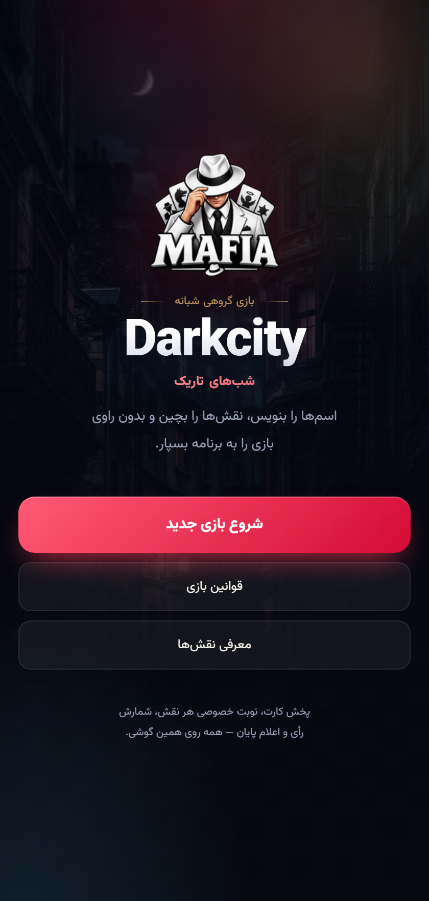
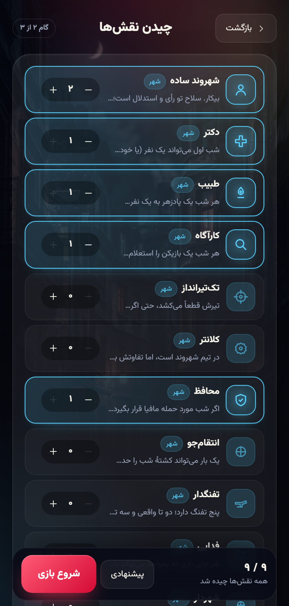
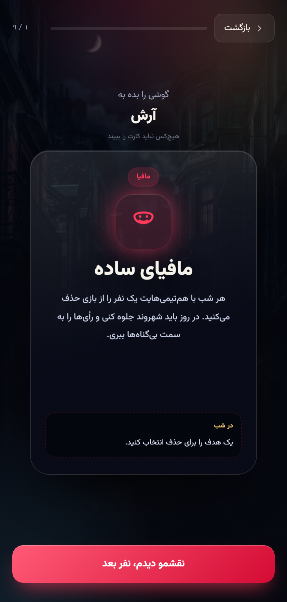
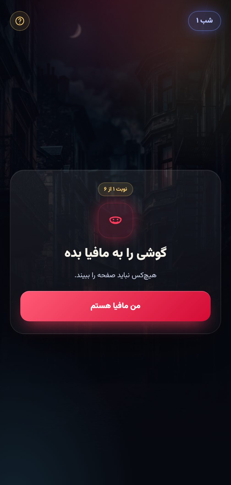
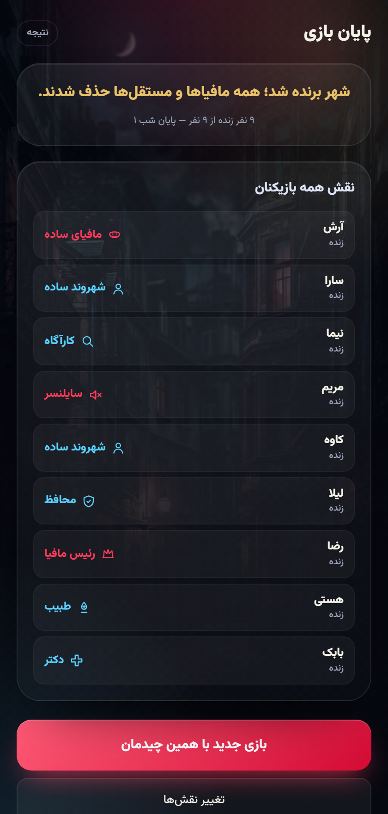
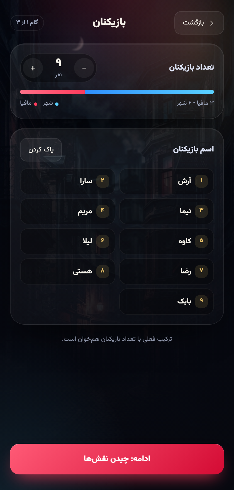

# Darkcity — مافیا

بازی گروهی مافیا برای یک گوشی؛ بدون راوی انسانی، بدون اینترنت و بدون نصب. اسم بازیکنان را وارد می‌کنی، نقش‌ها را می‌چینی و برنامه خودش نوبت‌های شب، کشته‌ها، رأی‌گیری، صداهای بازی و پایان کار را اداره می‌کند.



## امکانات

- **۳۳ نقش:** شهر، مافیا و مستقل — از دکتر و کارآگاه تا ناقل، زودیاک، فراماسون، شهردار، سم‌ساز و معشوقه.
- **بدون راوی:** هر نقش در نوبت خودش یک صفحهٔ خصوصی می‌گیرد، هدفش را انتخاب می‌کند و صفحه بسته می‌شود.
- **صداهای خودکار و مخفی:** شب، صبح، بیدار شدن مافیا و اعلام برنده، بدون هیچ پخش‌کننده یا دکمهٔ اضافه در صفحه.
- **اسم به‌جای شماره:** ۵ تا ۲۰ بازیکن با اسم دلخواه؛ ترکیب شهر و مافیا به‌صورت زنده نمایش داده می‌شود.
- **چیدن نقش:** شمارندهٔ هر نقش و دکمهٔ «پیشنهادی» برای ترکیب متعادل.
- **پخش مخفی کارت:** کارت با انیمیشن باز می‌شود و تا بسته‌شدن کامل کارت، نقش نفر بعد نمایش داده نمی‌شود.
- **شب و روز:** شلیک مافیا، نجات، محافظت، استعلام، سم، پادزهر، طاعون، دعوت ماسونی، شلیک روزانه و ده‌ها توانایی دیگر.
- **رأی‌گیری مخفی:** هر بازیکن رأی خودش را روی همان گوشی ثبت می‌کند؛ برنامه رأی‌ها را می‌شمارد و وکیل، شهردار یا فدایی می‌توانند حکم را برگردانند.
- **آفلاین و موبایل‌پسند:** راست‌به‌چپ، فونت محلی Vazirmatn، بدون build و بدون هیچ وابستگی خارجی.

## اجرا

هیچ مرحلهٔ ساخت یا نصبی ندارد. کافی است `index.html` را باز کنی:

- روی کامپیوتر: دوبار کلیک روی `index.html`
- روی گوشی: فایل‌ها را کنار هم نگه دار و `index.html` را با مرورگر باز کن
- یا با یک سرور محلی ساده:

```bash
python -m http.server 5173
# سپس http://127.0.0.1:5173/index.html
```

> اسکریپت‌ها عمداً «کلاسیک» و بدون ES Module هستند تا اجرای مستقیم فایل با `file://` هم کار کند.
> صداها با اولین لمس صفحه آزاد می‌شوند؛ اگر مرورگر پخش خودکار را قفل کند، بازی بی‌صدا ادامه پیدا می‌کند.

### انتشار روی GitHub Pages

پروژه کاملاً استاتیک است، پس بدون هیچ تنظیم اضافه‌ای منتشر می‌شود: در ریپازیتوری به **Settings → Pages** برو و شاخهٔ `main` و پوشهٔ `/ (root)` را انتخاب کن. آدرس صفحه چیزی شبیه `https://<username>.github.io/<repo>/` می‌شود.

## ساختار پروژه

```
index.html                 همهٔ صفحه‌ها، بدون منطق بازی
styles/
  base.css                 فونت، رنگ، پس‌زمینه، چیدمان
  components.css           دکمه، پنل، فهرست نقش، کارت مرحله، هدف‌ها
  pages.css                صفحهٔ خانه، کارت پخش، هدر بازی، پایان
js/
  app.js                   راه‌انداز: mount صفحه‌ها و شروع
  store.js                 وضعیت مشترک بازی و ترکیب نقش‌ها
  core/
    dom.js                 کمک‌های DOM و عدد فارسی
    icons.js               مجموعهٔ آیکون‌های یکدست
    router.js              ناوبری صفحه‌ها + تاریخچه (دکمهٔ برگشت گوشی)
  data/
    roles.js               تعریف ۳۳ نقش و آیکون‌ها
    nightFlow.js           ترتیب نوبت‌های شب
  engine/
    rules.js               شمارش تیم‌ها و شرط پایان
    night.js               صف نوبت‌ها، هدف‌های مجاز و نتیجهٔ شب
    day.js                 رأی‌گیری، اعدام، وکیل، شهردار، فدایی و تیر روزانه
  services/
    sound.js               پخش مخفی فایل‌های صوتی
    voice.js               اعلام صوتی با گفتار فارسی (اختیاری)
    timer.js               تایمر روز
  pages/                   یک فایل برای هر صفحه:
    home, players, roles, deal, game, guide, rolesGuide, end
Music/                     صداهای بازی (wav)
assets/
  fonts/Vazirmatn.woff2
  icon-192.png, icon-32.png
  images/mafia-night.jpg    پس‌زمینه
  images/mafia-logo-mono.png
screens/                   تصاویر همین README
```

## صداها

| فایل | کجا پخش می‌شود | جمله |
| --- | --- | --- |
| `Music/night.wav` | شروع هر شب | شب می‌شه و شهر به خواب می‌ره |
| `Music/mafia.wav` | نوبت مافیا | مافیا بیدار شه، به کی شلیک می‌کنه؟ |
| `Music/dawn.wav` | اعلام صبح | صبح شد، شهر بیدار شه |
| `Music/city-win.wav` | پایان با برد شهر | تبریک می‌گم، شهروندان برنده شدن |
| `Music/mafia-win.wav` | پایان با برد مافیا | تبریک می‌گم، مافیا برنده شد |

هیچ `<audio>` یا دکمهٔ پخشی در HTML نیست؛ فایل‌ها در `js/services/sound.js` به‌صورت `Audio` در حافظه ساخته می‌شوند و فقط در همان مرحله پخش می‌شوند. برای عوض کردن صدا کافی است فایل هم‌نام را جایگزین کنی.

## نقش‌ها

### شهر

| نقش | توانایی |
| --- | --- |
| شهروند ساده | بیکار؛ فقط رأی و استدلال |
| دکتر | شب اول نجات یک نفر، شب‌های بعد فقط خودش؛ دو بار |
| طبیب | هر شب پادزهر؛ سم همان شب را باطل می‌کند |
| کارآگاه | استعلام مافیا بودن؛ رئیس مافیا منفی است |
| تک‌تیرانداز | تیرش قطعاً می‌کشد، حتی شهروند را |
| کلانتر | فقط مافیا را می‌کشد؛ اشتباه = حذف خودش |
| محافظ | یک‌بار در برابر حمله زنده می‌ماند |
| انتقام‌جو | حدس کشتهٔ شب؛ در صورت درستی تفنگ روزانه می‌گیرد |
| تفنگدار | ۵ تفنگ (۲ واقعی، ۳ مشقی) به بازیکنان می‌دهد |
| فدایی | خودش را جای محکوم اعدام فدا می‌کند |
| شهردار | یک‌بار حکم اعدام را لغو می‌کند |
| گورکن | دو بار نقش حذف‌شده‌ها را می‌بیند |
| جادوگر | یک‌بار توانایی یک نفر را ۲۴ ساعت می‌گیرد |
| شهروند خاص | با نصف شدن بازیکنان، نقش یک شهروند حذف‌شده را می‌گیرد |
| فراماسون | هر شب یک نفر را دعوت می‌کند؛ مافیا = حذف کل تیم |
| تایلر | شهروند سادهٔ عضو تیم ماسونی |
| شرط‌بند | دو بار توانایی یک نفر را دو برابر می‌کند |
| وکیل | یک‌بار حکم اعدام را لغو می‌کند |
| سرباز | یک‌بار در برابر شلیک شب زنده می‌ماند |

### مافیا

| نقش | توانایی |
| --- | --- |
| مافیای ساده | شلیک شبانه با تیم |
| رئیس مافیا | رهبر تیم؛ استعلامش منفی است |
| گروگان‌گیر | یک نفر را تا پایان روز ساکت می‌کند |
| قهرمان | هر دو شب یک نفر را ۲۴ ساعت بیمه می‌کند |
| جاسوس | اگر ماسون‌ها بیدارش کنند، به تیم آن‌ها می‌پیوندد |
| سایلنسر | هر شب یک نفر را لال می‌کند |
| معشوقه | با حذف رئیس مافیا، رهبر تیم می‌شود |
| شعبده‌باز | توانایی یک نفر را یک شب می‌دزدد |
| دکتر لکتر | هم‌تیمی‌ها را درمان می‌کند، نه خودش را |
| سم‌ساز | یک‌بار سم؛ شب سم‌پاشی مافیا شلیک ندارد |

### مستقل

| نقش | توانایی |
| --- | --- |
| زودیاک | شب‌های زوج شلیک؛ از تیر شب در امان؛ محافظ = حذف خودش |
| ناقل | آلوده: لال → بی‌توان → بی‌رأی → مرگ |
| قاتل زنجیره‌ای | هر شب یک حذف، برای خودش |
| دلقک | فقط با اعدام شدن در روز برنده می‌شود |

## جریان بازی

1. **بازیکنان:** تعداد و اسم‌ها.
2. **نقش‌ها:** چیدن ترکیب (یا «پیشنهادی») تا وقتی تعداد نقش‌ها با تعداد بازیکنان برابر شود و حداقل یک مافیا و یک شهروند وجود داشته باشد.
3. **پخش کارت:** گوشی دست‌به‌دست می‌شود؛ هر نفر کارت خودش را می‌بیند و می‌بندد.
4. **شب:** برای هر نقش، صفحهٔ «گوشی را به … بده» و بعد انتخاب خصوصی هدف.
5. **صبح:** برنامه کشته‌ها و اتفاق‌های شب را اعلام می‌کند.
6. **روز:** بحث با تایمر، تیر روزانهٔ اختیاری، سپس رأی‌گیری مخفی و اعلام اعدام.
7. **پایان:** اعلام برنده، پخش صدای برد و افشای نقش همه.

## توسعه

- **افزودن نقش:** یک ورودی در `js/data/roles.js` (نام، تیم، آیکون، توضیح، `act` و `max`) و یک مرحله در `js/data/nightFlow.js`. موتور بازی از همان `act` استفاده می‌کند.
- **افزودن صفحه:** یک `section.screen` در `index.html`، یک فایل در `js/pages/` و ثبت آن با `M.router.register(name, element, onEnter)`.
- **قراردادها:** همهٔ ماژول‌ها روی `window.Mafia` کار می‌کنند؛ اسکریپت‌ها کلاسیک و به ترتیب در `index.html` بارگذاری می‌شوند (بدون باندلر).
- **وضعیت:** تنها منبع حقیقت `M.state` در `js/store.js` است.

## تصاویر

| چیدن نقش‌ها | کارت نقش | شب |
| --- | --- | --- |
|  |  |  |

| پایان بازی | بازیکنان |
| --- | --- |
|  |  |

## نکته‌ها

- اعلام صوتی با گفتار فارسی به موتور گفتار دستگاه وابسته است؛ اگر نصب نباشد، بازی بی‌صدا ادامه می‌یابد.
- برای نمایش بهتر روی گوشی، صفحه را به حالت تمام‌صفحه یا «افزودن به صفحهٔ اصلی» ببر.
- بازی روی مرورگرهای مدرن موبایل و دسکتاپ تست شده است.

---

Offline Persian Mafia party game for a single phone: 33 roles, hidden role cards, private night turns, secret voting, hidden sound effects and automatic win detection. Plain HTML/CSS/JS, no build step, no dependencies — just open `index.html`.
